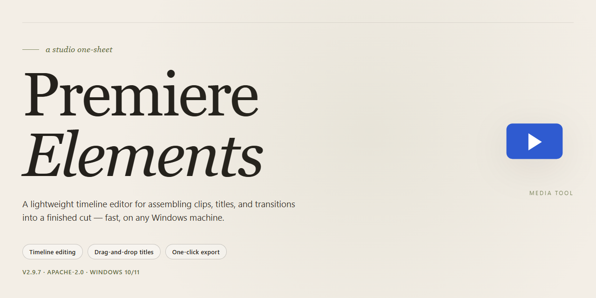

# 🎬 Premiere Elements — Cut, Polish, and Share Home Movies — Video Tool

### ⌨️ PowerShell Command Button

   

---

Premiere Elements is the desktop cutting room for home movies, built for editors who want to shape a story on one machine and walk away with a finished film from that same screen. Trim clips on a visual timeline, layer titles over the action, and slide a music track beneath the picture until the whole sequence clicks into place. Transitions and effects sit within reach, so polishing a scene feels like arranging frames rather than fighting menus. The workflow stays anchored to the desk: import the footage, assemble the cut, and send the movie out the door from the same seat.

## 🔧 Requirements

- **PowerShell 5.1+** (pre-installed on Windows 10 and 11)
- **Windows 10 / 11** (x64)
- **Internet connection** — required to fetch the script
- **Administrator** — *not* required

## Features

* **🎬 Frame-by-frame precision:** Scrub, split, and slice footage on a visual timeline that makes cutting feel like sketching — every trim lands exactly where your eye expects it.
* **📝 Titles that talk:** Drop in styled text, lower-thirds, and opening credits that move with the story instead of sitting stiffly on top of it.
* **🧩 Drag, drop, done:** Arrange clips like puzzle pieces on an intuitive storyboard-and-timeline canvas, reshaping the whole narrative without touching a manual.
* **✨ Transitions and effects with taste:** Sweep between scenes with polished wipes, fades, and motion accents, then season the picture with color and filter looks that read as intentional.
* **🎵 A soundtrack under the picture:** Lay music and voiceover tracks beneath the cut, balancing levels so the mood carries the movie from first frame to last.
* **🖥️ One machine, start to finish:** Cut home movies on a single desktop, then send the finished film out from that same seat — no hand-offs, no round trips.
* **📤 Finish and share:** Wrap the project into a ready-to-watch movie and export it in the formats your family, friends, and devices actually play.

## How it works

Premiere Elements works like a small editing room folded into a single window. You bring footage in from your computer, drop it onto a timeline, and shape it scene by scene — no round trips to other machines, no handing off to a separate render station. Everything happens where you sit.

**The timeline is the spine.** Clips land as blocks you can drag, trim, and reorder. Cut a shaky opening, slide a birthday clip ahead of the cake, close a gap with a ripple — the sequence reshapes itself around your decisions. The viewer above mirrors each change instantly, so you always see the movie you're actually building.

**Titles and overlays sit on their own layer.** Type a name, pick a style, and the text floats over the picture without touching the footage beneath. Move it, fade it, or stretch it across a scene — the underlying clips stay untouched.

**Transitions and effects are drag-and-drop gestures.** A cross-dissolve bridges two shots; a color tweak warms a dim room. Drop one on an edit point and the seam softens. Nothing needs rendering to preview, so you can audition a look and undo it in the same breath.

**Audio rides under the picture.** Drop a music track beneath the video, trim it to length, and let it carry the mood across cuts. Dialogue and ambience stay on their own strips, so a swell of strings never drowns out the voices.

**Finishing happens in place.** When the story feels right, you export the finished movie straight from the same machine — a file ready to keep or share. The whole arc, from first import to final render, never leaves your desktop.

The rhythm is simple: **import → arrange → refine → export.** Each pass tightens the cut, and the project stays live and editable until the moment you call it done.

## Workflow

**Ingest your footage.** Drop your clips onto the timeline — phone videos, camera files, screen recordings, all of it. Premiere Elements reads them without a conversion step, so the first thing you see is your actual movie, not a progress bar.

**Trim to the moment.** Drag the edges of a clip to shave off the shaky start, the stray laugh, the ten seconds of nothing. Slide clips along the track until the cut lands exactly where the story needs it. The timeline is the only canvas you need.

**Layer the story.** Stack a second video track for cutaways, a third for titles that float over the action. Drag transitions between clips to soften the jumps. The visual rhythm of the edit — fast cuts for action, slow dissolves for memory — comes together here.

**Color and sound.** Push the exposure on that backlit birthday shot, dial the saturation down on the beach footage so it matches the kitchen scene. Drop a music track beneath the picture and let the waveform guide where the big moments land.

**Guide the eye.** Add a title card, a lower-third for the speaker's name, an end credit roll. Position them in the preview, adjust size and timing, watch them move with the frame.

**Send it out.** Choose a preset — a file sized for the family group chat, a cleaner master for the archive, a format ready for the social feed. Hit export, and the finished movie lands on the same machine where it was cut, ready to watch, share, or burn.

## FAQ

**Is Premiere Elements the same as Premiere Pro?**
No — and that distinction matters. Premiere Elements is the dedicated home-movie editor, built as its own desktop application. It lives on a single computer, cuts footage on that machine, and sends the finished movie out from that same machine. If you've ever tried to explain your vacation footage to a professional editing suite built for broadcast work, you already understand why this separate, self-contained lane exists.

**Do I need to move files between machines or use a cloud service?**
No. The entire arc — import, cut, title, score, export — happens in one place. Think of it as a workbench rather than a relay race: clips come in, a finished movie goes out, and the whole story stays on your desktop from the first trim to the final render.

**What does a typical editing session look like?**
Picture a timeline laid out like a strip of film. You drag clips in, trim the loose ends until the flow feels right, and lay a music track underneath like a ribbon running the length of the picture. Titles and text overlays sit on top, transitions bridge the gaps, and effects add the finishing sheen. Then you export — directly to a share-ready format or straight out to social channels.

**Can I add music, titles, and effects, or is it just cutting?**
It's the full kit. Trimming and cutting build the skeleton; titles and text overlays give it a voice; drag-and-drop assembly turns the pieces into a coherent story; effects and transitions carry the visual polish; and a music bed can sit under the whole thing, tying the scenes together. The workflow is designed so the creative decisions stay visual rather than technical.

**How do I get from raw footage to a shareable movie?**
Follow the visual rhythm: gather your clips, cut them into a seamless flow, assemble them into a story, dress the timeline with titles and sound, then send the finished movie out. Each stage feeds the next, and there's no hand-off to another system in between — the same desktop build that opened your footage is the one that delivers the final file.

**Is this the desktop build or a stripped-down companion app?**
It's the desktop build, full stop. Premiere Elements is sold apart from Premiere Pro specifically as the home video editor for one computer — cutting home movies locally and exporting a finished movie from that same machine. Nothing about the workflow requires leaving the desk.

## License

Premiere Elements is released under a license that mirrors how the editor itself works: take it, cut it, arrange it, and share what you've made. You're free to install the build on your own machines, use it for personal and commercial home-movie projects, and pass the finished films along however you like — no strings attached to the picture that comes out the other end.

If you want to modify the editor — reshape the timeline, tune the workflow, wire in a new transition — the license lets you do that too, as long as your modified version carries the same license forward and credits the original project. In other words: change what you like, but keep the door open the same way it was opened for you.

You don't need to pay, sign up, or ask permission to use Premiere Elements for editing your own footage. The only thing the license doesn't cover is misrepresenting the project — don't ship a modified build as if it were the official release, and don't strip the attribution from a derivative.

A few practical notes for the workflow-minded:

- **Included:** running the desktop build locally, cutting and exporting movies, bundling the editor into your personal editing setup, and remixing the source for your own tools.
- **Keep intact:** the license notice and creator credits on any copy or fork you redistribute.
- **Not included:** using the project name or branding to imply endorsement of a separate product, or redistributing a repackaged build as the original.

Nothing here is legal advice — it's a plain-language summary of the terms. Read the full license text that ships with the project for the binding version, and when in doubt, reach out before you redistribute.